# Implementation Roadmap — Water Disconnection and Reconnection Operations Management System
## Web GIS & Android Native (Kotlin) Mobile Application

**Course:** Geographic Information Systems (INF 442)  
**Term:** 2/2026  
**System:** VisorDatosSIG / GeoIT Operations  
**Technology Stack:**
- **Database:** Microsoft SQL Server 2022 (with spatial `geometry`/`geography` types).
- **Backend:** .NET 10 Web API (C#) + NetTopologySuite.
- **Frontend Web:** React 19 + TypeScript + Vite + Tailwind CSS + MapLibre / Leaflet.
- **Mobile Application:** Android Native in **Kotlin** (Jetpack Compose / ViewBinding + MVVM + Retrofit + Coroutines + CameraX + Google Play Services Location + Google ML Kit Text Recognition).

---

## 1. Architectural Overview

```mermaid
graph TD
    subgraph Database SQL Server
        DB1[(dbo.Vias - Road Network)]
        DB2[(dbo.CodigosFijos)]
        DB3[(dbo.Asignaciones)]
        DB4[(dbo.AsignacionDetalles)]
        DB5[(dbo.MonitoreoTracking)]
    end

    subgraph Backend .NET 10 API
        B1[RoadNetworkGraphService<br/>In-memory Graph & Dijkstra]
        B2[AssignmentService<br/>1..N Route Sequencing]
        B3[TrackingService<br/>Telemetry & Playback]
        B4[MobileGateway<br/>Mobile Endpoints & Photo Upload]
    end

    subgraph Web Frontend React
        W1[GeoIT Menu & Operations Dashboard]
        W2[Disconnection & Reconnection Assignments<br/>Map Click + Route Tracing]
        W3[Monitoring with Temporal Playback<br/>Play/Pause/Slider/Speeds]
        W4[2D / 3D Viewer with Pitch Tilt]
    end

    subgraph Android Kotlin Mobile App
        M1[Operator Login & Session]
        M2[Sequenced Task List 1..N]
        M3[Stop Detail & GPS Accuracy Check]
        M4[CameraX - Evidence Photo & ML Kit OCR]
        M5[Foreground Service<br/>Periodic Telemetry Tracking]
        M6[Google Maps Intent - Turn-by-Turn Navigation]
    end

    DB1 --> B1
    DB2 --> B2
    B2 --> DB3
    B2 --> DB4
    B3 --> DB5

    W1 <--> B2
    W2 <--> B2
    W3 <--> B3
    W4 <--> B2

    M1 <--> B4
    M2 <--> B4
    M3 <--> B4
    M4 --> B4
    M5 --> B3
```



---

## 2. Phase 1: Data Model and Road Network Topology (SQL Server)

### 2.1. Database Migration Script: `ScriptDatabase/10_Asignaciones_Tracking.sql`
Create transactional schema to store operational dispatches, sequenced stops, and live telemetry:

1. **Table `dbo.Asignaciones` (Dispatch Header):**
   ```sql
   CREATE TABLE dbo.Asignaciones (
       IdAsignacion INT IDENTITY(1,1) PRIMARY KEY,
       IdUsuario INT NOT NULL FOREIGN KEY REFERENCES dbo.Usuarios(Id),
       TipoAsignacion VARCHAR(20) NOT NULL CHECK (TipoAsignacion IN ('Corte', 'Reconexion')),
       FechaAsignacion DATETIME2 NOT NULL DEFAULT SYSUTCDATETIME(),
       PuntoPartidaLat FLOAT NOT NULL,
       PuntoPartidaLon FLOAT NOT NULL,
       CantidadCodigos INT NOT NULL,
       Estado VARCHAR(20) NOT NULL DEFAULT 'Asignada' CHECK (Estado IN ('Asignada', 'EnProgreso', 'Finalizada', 'Cancelada'))
   );
   CREATE INDEX IX_Asignaciones_Usuario_Fecha ON dbo.Asignaciones(IdUsuario, FechaAsignacion);
   ```

2. **Table `dbo.AsignacionDetalles` (Stops Sequenced by Dijkstra):**
   ```sql
   CREATE TABLE dbo.AsignacionDetalles (
       IdAsignacionDetalle INT IDENTITY(1,1) PRIMARY KEY,
       IdAsignacion INT NOT NULL FOREIGN KEY REFERENCES dbo.Asignaciones(IdAsignacion) ON DELETE CASCADE,
       IdCodigo INT NOT NULL FOREIGN KEY REFERENCES dbo.CodigosFijos(Id),
       OrdenSecuencia INT NOT NULL,
       Estado VARCHAR(20) NOT NULL DEFAULT 'Pendiente' CHECK (Estado IN ('Pendiente', 'Cortado', 'Reconectado', 'Observado')),
       LecturaMedidor VARCHAR(50) NULL,
       Observacion NVARCHAR(500) NULL,
       FotoEvidenciaUrl NVARCHAR(500) NULL,
       LatitudEjecucion FLOAT NULL,
       LongitudEjecucion FLOAT NULL,
       FechaHoraEjecucion DATETIME2 NULL,
       DistanciaDesvioMetros FLOAT NULL,
       CONSTRAINT UQ_Asignacion_Secuencia UNIQUE (IdAsignacion, OrdenSecuencia)
   );
   CREATE INDEX IX_AsignacionDetalles_Estado ON dbo.AsignacionDetalles(IdAsignacion, Estado);
   ```

3. **Table `dbo.MonitoreoTracking` (Operator Telemetry):**
   ```sql
   CREATE TABLE dbo.MonitoreoTracking (
       IdTracking BIGINT IDENTITY(1,1) PRIMARY KEY,
       IdUsuario INT NOT NULL FOREIGN KEY REFERENCES dbo.Usuarios(Id),
       IdAsignacion INT NULL FOREIGN KEY REFERENCES dbo.Asignaciones(IdAsignacion),
       Latitud FLOAT NOT NULL,
       Longitud FLOAT NOT NULL,
       VelocidadKmh FLOAT NULL,
       FechaHora DATETIME2 NOT NULL DEFAULT SYSUTCDATETIME(),
       Evento NVARCHAR(100) NULL
   );
   CREATE INDEX IX_MonitoreoTracking_Usuario_Fecha ON dbo.MonitoreoTracking(IdUsuario, FechaHora);
   ```

### 2.2. Road Network Topology (`dbo.Vias`)
- Validate that `dbo.Vias` geometries are valid WGS84 (SRID 4326).
- Extract network nodes (intersections and endpoints) and edges with metric segment lengths.

---

## 3. Phase 2: Backend .NET 10 & Dijkstra Routing Engine

### 3.1. Road Network Graph & Dijkstra Algorithm (`RoadNetworkGraphService.cs`)
1. **In-Memory Graph Representation:**
   - **Node:** `NodeId`, `Point` (Lon, Lat).
   - **Edge:** `EdgeId`, `SourceNodeId`, `TargetNodeId`, `WeightMeters`, `Geometry` (`LineString`).
   - Graph built by reading line segments from `dbo.Vias`. Shared endpoints within a metric tolerance are indexed as the same node.
2. **Road Snap Projection:**
   - Method `FindNearestNodeOrEdge(double lat, double lon)`: Projects departure points and water meters onto the closest road centerline segment.
3. **Dijkstra Algorithm:**
   - Method `ComputeShortestPath(int startNode, int endNode)`:
     - Uses `PriorityQueue<int, double>` for optimal $O((E + V) \log V)$ execution.
     - Returns cumulative distance and exact concatenated street segment geometries.
     - **Strict Rule:** Movement adheres strictly to road network edges, **preventing routes from crossing city blocks (manzanas)**.

### 3.2. Assignment and Route Sequencing (`AssignmentService.cs`)
1. **Candidate Filtering:**
   - Target status matching (`Corte` -> `IdEstado = 3` "Para corte"; `Reconexion` -> `IdEstado = 2` "Cortado").
   - Filter the $N$ nearest candidate meters relative to the operator's departure point.
2. **Stop Ordering ($1 \dots N$):**
   - From departure point $P_0$, find nearest target $P_1$ via street network Dijkstra.
   - From $P_1$, greedily find closest unvisited target $P_2$, repeating through $P_N$ (Nearest Neighbor over Dijkstra distance matrix).
   - Generate GeoJSON `FeatureCollection` output:
     - Continuous road line geometries.
     - Sequenced stop point features with metadata (order, fixed code, client name, status).

### 3.3. API Endpoints (`VisorDatosSig.Api/Program.cs`)
- `GET /api/asignaciones/operadores`: Operators list (roles `Cortador`, `Reconexion`) with daily workload counts.
- `POST /api/asignaciones/calcular-ruta`: Takes `{ tipo, cantidad, puntoPartida: { lat, lon } }` and returns computed GeoJSON route with numbered stops.
- `POST /api/asignaciones/guardar`: Saves assignment header and details in a single database transaction.
- `GET /api/mobile/mis-asignaciones`: Fetches authenticated operator's active task sheet with $1 \dots N$ sequence.
- `POST /api/mobile/tracking`: Batched or real-time GPS coordinate ingestion from mobile operators.
- `POST /api/mobile/ejecutar-corte`: Multi-part endpoint receiving meter photo, current reading, status, observation note, and execution GPS coordinates.
  - Verifies geographical distance against meter coordinates for anti-fraud auditing.
  - Automatically updates meter status in `dbo.CodigosFijos` (transitions to `Cortado` or `Normal`).
- `GET /api/monitoreo/recorridos`: Chronologically returns operator position traces for web playback.

---

## 4. Phase 3: Web Application — Planning and Supervision

### 4.1. Navigation Menu Restructuring ("GeoIT Operations")
Update `AuthenticatedLayout.tsx` to match the target navigation hierarchy:
- **Dashboard**:
  - *General Dashboard* (`/dashboard`)
  - *General Map View* (`/map`)
- **Assignments**:
  - *Disconnection Assignments* (`/assignments/cuts`)
  - *Reconnection Assignments* (`/assignments/reconnections`)
- **Monitoring**:
  - *Personnel Tracking* (`/monitoring`)
- **Geographic Information**: Shapefile Migration and Cadastral Queries (`/migration`, `/queries`)
- **User Profile & Logout**

### 4.2. Operational Dashboard (`DashboardPage.tsx`)
- Status metric cards:
  - Total Connections (e.g., 6,271).
  - Normal (Green - `#16a34a`).
  - To be disconnected (Orange - `#f97316`).
  - Disconnected (Red - `#dc2626`).
  - Partial deactivation (Purple/Brown - `#8b5cf6`).
  - Full deactivation (Gray - `#6b7280`).
- Donut chart showing overall status distribution.
- Daily progress bar chart showing completed vs. pending disconnections.

### 4.3. Interactive Assignment Views (`AssignmentPage.tsx`)
- Left configuration panel:
  - Qualified operator dropdown (`Cortador` or `Reconexion`).
  - "Current pending tasks" status badge.
  - Numeric input: "Quantity of orders to assign" (e.g., 10, 20, 30).
  - Departure point status indicator ("Click anywhere on map to set start point").
- Map interaction:
  - Mouse click captures coordinates and places departure marker.
  - Action button: **"Calculate optimal route"** -> triggers `/api/asignaciones/calcular-ruta`.
  - Renders blue street path and numbered circular markers: `①`, `②`, `③`...
  - Side panel listing sequenced stops: Order, Fixed Code, Client Name, Distance.
  - Action button: **"Save assignment"** -> commits dispatch to database.

### 4.4. Personnel Monitoring & Temporal Playback (`MonitoringPage.tsx`)
- Top filters: Date, Operator, Activity.
- Map view:
  - Planned route vs. actual traveled path.
  - Animated vehicle/operator icon moving along trajectory.
- **Interactive Playback Bar:**
  - Controls: *Reset*, *Play / Pause*.
  - Timeline slider to seek to any point of the shift.
  - Speed selector: `1x`, `2x`, `4x`.
  - Configurable dwell pause (e.g., 3-second hold at each work stop).
  - Dynamic status label:
    - *"14/48 · Traveling towards Disconnection #97"*
    - *"7/48 · Stopped at Disconnection #95 (4 min)"*

### 4.5. 2D / 3D Viewer with Pitch Tilt (`MapPage.tsx`)
- View mode toggle:
  - **2D View (Zenith):** 0° pitch, standard flat view.
  - **3D View (Tilted):** 60° pitch and bearing rotation to display urban depth and block geometry.

---

## 5. Phase 4: Native Android Mobile Application in Kotlin

Built from scratch in a dedicated `mobile/` directory.

### 5.1. Android Project Configuration (`mobile/`)
- **Language:** Kotlin 2.x
- **Build System:** Gradle (Kotlin DSL `build.gradle.kts`)
- **Min SDK:** 26 (Android 8.0) | **Target SDK:** 34/35 (Android 14/15)
- **Architecture:** Clean Architecture + MVVM (Model-View-ViewModel).
- **Core Libraries:**
  - `androidx.core:core-ktx`, `androidx.lifecycle:lifecycle-viewmodel-ktx`
  - **UI:** Jetpack Compose (or XML Views with Material 3 / ViewBinding)
  - **Network:** `com.squareup.retrofit2:retrofit`, `converter-gson`, `logging-interceptor`
  - **Images:** `io.coil-kt:coil`
  - **Camera:** `androidx.camera:camera-core`, `camera-camera2`, `camera-lifecycle`, `camera-view`
  - **Geolocation:** `com.google.android.gms:play-services-location`
  - **Local Persistence (Offline Cache):** `androidx.room:room-runtime`, `room-ktx`
  - **Background Work:** `androidx.work:work-runtime-ktx`
  - **Bonus OCR:** `com.google.android.gms:play-services-mlkit-text-recognition`

### 5.2. Kotlin Package Structure
```text
mobile/
└── app/
    └── src/
        └── main/
            ├── AndroidManifest.xml
            ├── java/com/visordatossig/operaciones/
            │   ├── data/
            │   │   ├── api/ (AuthApi, AssignmentApi, TrackingApi)
            │   │   ├── local/ (AppDatabase, TaskDao, TaskEntity)
            │   │   ├── model/ (User, Assignment, TaskItem, ExecutionResult)
            │   │   └── repository/ (AuthRepository, AssignmentRepository, TrackingRepository)
            │   ├── di/ (Dependency Injection)
            │   ├── service/ (LocationTrackingService, TrackingWorker)
            │   ├── ui/
            │   │   ├── login/ (LoginActivity, LoginViewModel)
            │   │   ├── tasklist/ (TaskListActivity, TaskListViewModel, TaskAdapter)
            │   │   ├── taskdetail/ (TaskDetailActivity, TaskDetailViewModel)
            │   │   └── camera/ (CameraActivity or CameraDialog)
            │   └── util/ (GpsHelper, OcrHelper, NetworkBoundResource)
            └── res/
                ├── layout/
                ├── drawable/
                └── values/
```

### 5.3. Mobile Screens and Operational Flow

#### Screen 1: Operator Login (`LoginActivity`)
- Credentials entry (Username and Password).
- Authentication against `/api/auth/login`.
- Encrypted token storage (`EncryptedSharedPreferences`).
- Role-based routing (`Cortador` or `Reconexion`).

#### Screen 2: Sequenced Task List (`TaskListActivity`)
- Header:
  - Operator full name and role.
  - Active date and pending task counter.
  - Primary button: **"START ROUTE"** (launches background GPS telemetry service).
- Order cards list:
  - Green circular badge with sequential stop order ($1, 2, 3 \dots$).
  - Fixed code (e.g., `CF-48201`).
  - Client full name.
  - Coordinate reference and distance estimation.
  - Visual status pill: *Pending* (gray), *Completed* (green), *Reported/Observed* (orange).
- Tapping a card opens order execution view.

#### Screen 3: Order Execution (`TaskDetailActivity`)
1. **Location & Navigation:**
   - Destination coordinates display.
   - Real-time GPS panel:
     - Button **"GET GPS"**: Triggers `FusedLocationProviderClient` with `Priority.PRIORITY_HIGH_ACCURACY`. Shows live coordinates and metric accuracy (e.g., *Accuracy: ±3.2m*).
     - Button **"NAVIGATE"**: Fires `Intent(Intent.ACTION_VIEW)` with `google.navigation:q=lat,lon&mode=d` (or `m` for motorcycle, `w` for walking), opening Google Maps with turn-by-turn spoken guidance.
2. **Field Execution Form:**
   - Numeric input: **"Current meter reading"**.
   - Result selector:
     - Radio button `(o) Cut / Reconnected`.
     - Radio button `( ) Observed`.
   - Text input: **"Observation reason"** (mandatory when *Observed* is selected, with quick chips: *"House closed"*, *"Aggressive dog"*, *"Inaccessible meter"*).
3. **Camera Capture (CameraX):**
   - Button **"TAKE PHOTO"**.
   - Captures evidence image and stores compressed preview in app cache.
   - Photo thumbnail preview with counter: *"Photos: 1/3"*.
4. **Anti-Fraud Certification & Submission:**
   - Primary button: **"SUBMIT EXECUTION"**.
   - **Strict Enforcement Rule:** The app automatically binds:
     - Device GPS coordinates at that exact instant.
     - Accurate UTC timestamp.
   - Sends `MultipartBody` (image + metadata) to `/api/mobile/ejecutar-corte`.
   - Local fallback: If connectivity drops, stores in `Room` database as `PendingSync` and uploads once connection is restored.

#### Screen 4 (Bonus Feature): Meter OCR via Google ML Kit (`OcrHelper.kt`)
- Immediately after photo capture with CameraX:
  - Pass `InputImage` to `TextRecognition.getClient(TextRecognizerOptions.DEFAULT_OPTIONS)`.
  - Extract numeric substrings matching meter dial patterns (4 to 7 digits).
  - Automatically populate "Current meter reading" input for operator confirmation, eliminating manual typing errors.

#### Background Telemetry Service (`LocationTrackingService.kt`)
- Persistent Foreground Service with ongoing system notification while route is active.
- Configures `LocationRequest` intervals (every 15–30 seconds or 25 meters delta).
- Transmits telemetry packets to `/api/mobile/tracking` to power live web monitoring.

---

## 6. Phase 5: Integration Testing, Packaging, and Deliverables

### 6.1. End-to-End Operational Lifecycle Validation
1. **Step 1 (Web):** Administrator logs in, accesses *Disconnection Assignments*, picks an operator, clicks the map for departure point, and requests 15 disconnections.
2. **Step 2 (Backend):** Dijkstra computes continuous route along street edges without crossing blocks and sequences stops $1 \dots 15$. Administrator saves assignment.
3. **Step 3 (Mobile):** Field worker logs in on Android Kotlin app, viewing the 15 ordered tasks.
4. **Step 4 (Mobile):** Worker taps "Navigate" for stop 1, arrives at location, snaps photo, verifies meter reading, acquires GPS, and saves.
5. **Step 5 (Web):** Web Dashboard and Map Viewer instantly reflect the updated status in red (*Cortado*).
6. **Step 6 (Web):** Administrator opens *Personnel Monitoring*, selects operator, and replays the trajectory using temporal playback.

### 6.2. Deliverable Preparation
1. **Database:** Export full SQL Server backup (`VisorDatosSig_Completo.bak`) alongside numbered scripts `01` to `10`.
2. **Mobile Application:** Generate signed Android APK (`app-release.apk` / `app-debug.apk`) installable on physical test devices.
3. **Documentation:**
   - Update `docs/Manual_de_Usuario_SIG.docx` with web and Kotlin mobile screenshots.
   - Update `docs/Manual_Tecnico_SIG.docx` with Dijkstra formulation and road network graph topology.
   - Update `docs/Entrega_y_Manual_Instalacion_SIG.docx` with backend, frontend, and Android build instructions.
4. **Submission Package:** Assemble repository files, APK, `.bak` database, and manuals into the specified Google Drive delivery link.

---

## 7. Execution Order Roadmap

| Step | Work Item | Area | Expected Output |
| :---: | :--- | :---: | :--- |
| **1** | Database schema script for assignments & tracking | SQL Server | `10_Asignaciones_Tracking.sql` executed with PKs, FKs, and indexes. |
| **2** | Road network graph & Dijkstra implementation | Backend C# | In-memory graph service computing shortest street paths. |
| **3** | Assignment & mobile API endpoints | Backend C# | Controllers / Minimal APIs for route calculation, storage, and photo upload. |
| **4** | Web interactive assignment view | Web React | Interactive map click, route drawing, and numbered stop pins. |
| **5** | GeoIT navigation menu & KPI dashboard | Web React | Restructured menu and live summary charts by service status. |
| **6** | Android Kotlin project setup (`mobile/`) | Mobile Kotlin | Gradle Kotlin DSL project with Retrofit, Room, and Login activity. |
| **7** | Mobile task list & turn-by-turn navigation | Mobile Kotlin | Sequenced $1 \dots N$ stops with Google Maps navigation intent. |
| **8** | Mobile camera capture, anti-fraud GPS & submission | Mobile Kotlin | CameraX photo capture, GPS validation, and multipart sync. |
| **9** | Background telemetry & Web playback player | Mobile / Web | Foreground service tracking and timeline playback UI. |
| **10** | Camera ML Kit OCR (Bonus) | Mobile Kotlin | Automatic reading of meter dial digits from captured photo. |
| **11** | End-to-end testing, APK build & documentation | Integration | Signed APK, database backup `.bak`, and updated manuals. |
