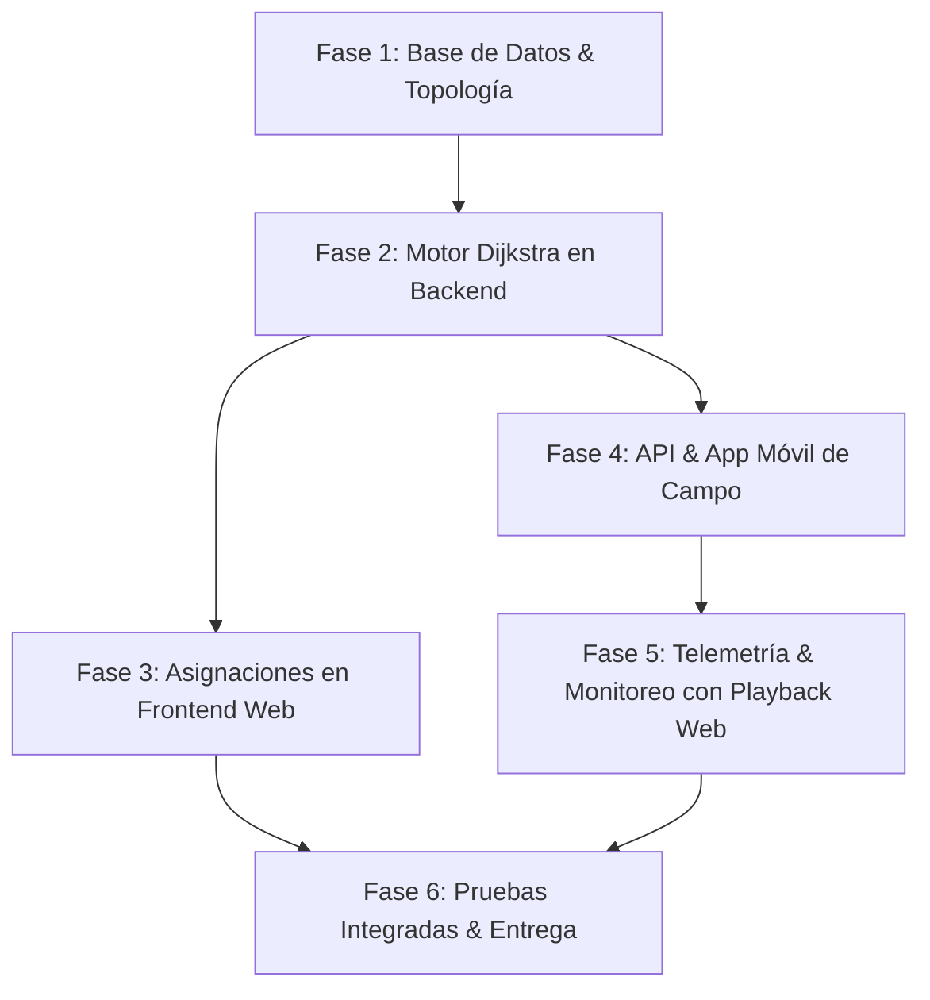

# Project Scope — Geographic Information System (GIS)

**Course:** Geographic Information Systems (INF 442)  
**Instructor:** Ing. Ubaldo Pérez  
**Term:** 2/2026  
**System:** VisorDatosSIG / GeoIT Operaciones  
**Reference Documents:** `AlcanceProyecto_2_2026.pptx` (Reference architecture & mockups) and `INF 442 SIG 2026-10-15 13_30(GMT-4_00).docx` (Official requirements and technical specifications).

---

## 1. Executive Summary & General Objective

The main objective of this **Geographic Information Systems Project** is the end-to-end development and integration of an **operational management and monitoring web platform** alongside a **field operations mobile application** for the complete lifecycle administration of **water service disconnections and reconnections (cortes y reconexiones)**.

El sistema permite planificar rutas óptimas sobre la red vial existente mediante el **algoritmo de Dijkstra**, despachar tareas a los trabajadores de campo (cortadores y reconectores), auditar en tiempo real y diferido sus desplazamientos, y certificar la ejecución de las órdenes mediante geolocalización GPS obligatoria, lecturas de medidor y fotografías de evidencia.

---

## 2. Matriz de Estado: Implementado vs. Pendiente

| Módulo / Requerimiento | Componente | Estado Actual | Brecha / Trabajo Restante |
| :--- | :--- | :---: | :--- |
| **Autenticación y Roles** | Web / Backend | 🟢 **100%** | Roles `Administrador`, `Cortador`, `Reconexion`, `Lecturador` configurados con JWT. |
| **Visor Catastral Base** | Web | 🟢 **90%** | Capas de Manzanas, Lotes, Vías y Códigos Fijos con colores normativos. Falta toggle 2D/3D con inclinación. |
| **Búsqueda y Filtros** | Web / Backend | 🟢 **100%** | Búsqueda por código fijo y nombre de abonado con dibujo progresivo optimizado. |
| **Consultas y Exportación** | Web / Backend | 🟢 **100%** | Reportes dinámicos con exportación a PDF y Excel. |
| **Administración de Usuarios** | Web / Backend | 🟢 **100%** | CRUD de usuarios, contraseñas y asignación de roles operativos. |
| **Menú y Navegación "GeoIT"** | Web | 🟡 **30%** | Falta estructurar la barra superior con los menús exactos del modelo: Dashboard, Asignaciones, Ejecución, Monitoreo. |
| **Dashboard General Operativo** | Web | 🟡 **60%** | Falta ajustar las tarjetas exactas (6.271 total, 3.828 normal, 221 para corte, etc.) y gráficos de dona y barras. |
| **Modelo Relacional de Asignaciones** | Base de Datos | 🔴 **0%** | Faltan tablas `dbo.Asignaciones`, `dbo.AsignacionDetalles` y `dbo.MonitoreoTracking`. |
| **Ruteo Vial con Dijkstra** | Backend | 🔴 **0%** | Falta implementar el algoritmo de Dijkstra sobre `dbo.Vias` con restricción de no cruzar manzanas. |
| **Asignación de Cortes y Reconexiones** | Web / Backend | 🔴 **0%** | Faltan vistas interactivas: selección de operador, clic en mapa para punto de partida, cálculo de ruta numerada (1..N) y guardado. |
| **Monitoreo con Reproductor (Playback)** | Web / Backend | 🔴 **0%** | Falta panel de seguimiento con filtros por fecha/operador, timeline, play/pausa, velocidad (1x) e indicador de paradas. |
| **Aplicación Móvil (Operaciones de Campo)**| Móvil | 🔴 **0%** | No existe en el repositorio. Requiere Login, Lista de tareas ordenadas, GPS, Navegación paso a paso, Cámara y guardado certificado. |

---

## 3. Lo que Ya Está Implementado (Línea Base del Proyecto)

1. **Seguridad y Control de Acceso:**
   - Autenticación con cookies HttpOnly seguras, tokens JWT, sesiones concurrentes auditadas y rotación de contraseñas.
   - Roles definidos en base de datos: `Administrador`, `Cortador`, `Reconexion`, `Lecturador` y `Catastro`.
   - Módulo administrativo en `/admin/users` para alta, baja y edición de credenciales y roles.
2. **Motor Cartográfico Web (MapLibre GL JS):**
   - Capas geográficas cargadas desde SQL Server (`geometry` convertida a GeoJSON).
   - Semántica de colores de códigos fijos según estado:
     - 🟢 **Normal (1)** — Verde
     - 🔴 **Cortado (2)** — Rojo
     - 🟠 **Para corte (3)** — Naranja
     - 🟤 **Baja parcial (4)** — Marrón
     - ⚫ **Baja total (5)** — Negro
3. **Rendimiento y Escalabilidad:**
   - Compresión HTTP nativa para capas geográficas (Gzip y Brotli).
   - *Progressive drawing* con programación de cuadros (*frame scheduling*) para renderizar más de 5.000 entidades sin bloquear el hilo principal de la interfaz.
4. **Módulo de Consultas y Reportes:**
   - Constructor de reportes con filtros alfanuméricos y ordenamiento validado.
   - Exportador nativo de tablas a formato Excel (`.xlsx`) y documentos PDF con diseño institucional.

---

## 4. Detailed Specification of the Implemented Scope

### 4.1. Base de Datos (Scripts SQL Transaccionales)

Deben crearse las estructuras para persistir el flujo de asignación, ejecución y telemetría:

1. **`dbo.Asignaciones` (Cabecera de Asignación):**
   - `IdAsignacion` (PK, INT IDENTITY)
   - `IdUsuario` (FK a `dbo.Usuarios`, cortador o reconector asignado)
   - `TipoAsignacion` (VARCHAR: `'Corte'` o `'Reconexion'`)
   - `FechaAsignacion` (DATETIME2)
   - `PuntoPartidaLat` / `PuntoPartidaLon` (FLOAT, coordenadas donde inicia el recorrido)
   - `CantidadCodigos` (INT)
   - `Estado` (VARCHAR: `'Asignada'`, `'EnProgreso'`, `'Finalizada'`)
2. **`dbo.AsignacionDetalles` (Órdenes Secuenciadas por Dijkstra):**
   - `IdAsignacionDetalle` (PK, INT IDENTITY)
   - `IdAsignacion` (FK a `dbo.Asignaciones`)
   - `IdCodigo` (FK a `dbo.CodigosFijos`)
   - `OrdenSecuencia` (INT, orden óptimo calculado: 1, 2, 3...)
   - `Estado` (VARCHAR: `'Pendiente'`, `'Cortado'`, `'Observado'`)
   - `LecturaMedidor` (VARCHAR/FLOAT, avance registrado)
   - `Observacion` (NVARCHAR, ej. "Casa cerrada", "Reja con candado")
   - `FotoEvidenciaUrl` (NVARCHAR, ruta o identificador de la foto tomada)
   - `LatitudEjecucion` / `LongitudEjecucion` (FLOAT, coordenadas GPS reales de campo)
   - `FechaHoraEjecucion` (DATETIME2, timestamp obligatorio de auditoría)
3. **`dbo.MonitoreoTracking` (Telemetría de Operadores en Campo):**
   - `IdTracking` (PK, BIGINT IDENTITY)
   - `IdUsuario` (FK a `dbo.Usuarios`)
   - `IdAsignacion` (FK a `dbo.Asignaciones`, opcional)
   - `Latitud` / `Longitud` (FLOAT)
   - `FechaHora` (DATETIME2)
   - `Evento` (NVARCHAR: `'En recorrido hacia Corte X'`, `'Detenido en Corte X'`, etc.)

---

### 4.2. Backend (.NET Web API) y Algoritmia

1. **Motor de Ruteo con Algoritmo de Dijkstra:**
   - **Fuente de datos:** Tabla `dbo.Vias` (líneas de ejes de calles).
   - **Construcción del Grafo:** Intersecciones de segmentos de vía como nodos, longitudes geográficas como pesos de arista.
   - **Restricción de Movimiento:** El cálculo del camino más corto debe circular estrictamente sobre la red vial, **sin atravesar manzanas**.
   - **Secuenciación:** Dado un punto de partida $(Lat_0, Lon_0)$ y un conjunto de $N$ suministros con estado "Para corte" o "Cortado", calcular la secuencia ordenada $1 \rightarrow 2 \rightarrow \dots \rightarrow N$ minimizando la distancia acumulada.
   - **Salida:** Polilínea GeoJSON de la ruta continua y lista ordenada de nodos de parada.
2. **Servicios y Controladores API:**
   - `GET /api/asignaciones/operadores`: Lista de cortadores/reconectores con cantidad de tareas pendientes.
   - `POST /api/asignaciones/calcular-ruta`: Recibe punto de partida, rol y cantidad de puntos; devuelve la ruta calculada y la lista secuenciada.
   - `POST /api/asignaciones/guardar`: Registra la asignación oficial para que se despache al móvil.
   - `GET /api/monitoreo/recorridos`: Consulta el historial de posiciones para el reproductor web.
   - `GET /api/mobile/mis-asignaciones`: Endpoint seguro para que la app móvil descargue su hoja de ruta diaria.
   - `POST /api/mobile/tracking`: Ingesta periódica de coordenadas enviadas por el cortador en trayecto.
   - `POST /api/mobile/ejecutar-corte`: Cierre de la orden con foto multipart, avance de medidor, estado, observación y validación de GPS.

---

### 4.3. Aplicación Web — Planificación y Supervisión

1. **Reorganización del Menú Superior (`GeoIT Operaciones`):**
   - Menú desplegable **Dashboard**:
     - *Ver Dashboard General*
     - *Visualización General* (Mapa)
   - Menú desplegable **Asignaciones**:
     - *Asignación de Cortes* (`AsigCortes`)
     - *Asignación de Reconexión* (`AsigReconexion`)
   - Menú desplegable **Monitoreo**:
     - *Monitoreo de Personal* (`MonitoreoPersonal`)
   - Menú **Información Geográfica / Catastro**
   - Menú de usuario con rol y botón *Cerrar sesión*.
2. **Vistas de Asignación de Cortes y Reconexiones:**
   - Selector del operador responsable (Juan, Pedro, etc.).
   - Tarjeta informativa con "Pendientes actuales".
   - Input para "Cantidad de códigos adicionales" a asignar.
   - **Captura interactiva de Punto de Partida:** Clic en cualquier punto del mapa para fijar el origen del trabajador (icono de marcador).
   - Botón **"Calcular ruta óptima"**: Invoca el algoritmo de Dijkstra, dibuja la ruta sobre las vías y ubica pines con números circulares (1, 2, 3... 30).
   - Panel lateral con la lista ordenada: `#1 - Código - Nombre del abonado`.
   - Botón **"Guardar asignación"**.
3. **Módulo de Monitoreo de Personal (Tracking y Reproductor Temporal):**
   - Filtros superiores: Selector de Fecha, Trabajador, Actividad (Corte/Reconexión) y botón *Actualizar*.
   - Tarjeta lateral: Datos del operador, cantidad de puntos visitados, metros recorridos y última hora reportada.
   - **Barra de reproducción interactiva (Playback):**
     - Botón Reiniciar, Play / Pausar.
     - Slider de progreso temporal.
     - Velocidad ajustable (1x, 2x).
     - Tiempo de detención configurable (ej. *Pausa 3s* en cada parada de corte).
     - Rótulo de estado contextual: *"14/48 · En recorrido hacia Corte 97"* / *"7/48 · Detenido en Corte 95"*.
4. **Visor Catastral y Modos de Vista:**
   - Toggle **Vista 2D / Vista 3D**.
   - Botones de acción rápida: **Vista inclinada** (rotación y pitch a 60°) y **Vista superior** (cenital 0°).

---

### 4.4. Aplicación Móvil — Operaciones en Campo (100% Pendiente)

La aplicación móvil es obligatoria para la calificación del proyecto y debe construirse desde cero:

1. **Pantalla de Inicio de Sesión:**
   - Autenticación con usuario y contraseña del cortador o reconector.
2. **Lista de Tareas Diarias (`Cortes pendientes`):**
   - Identificación del trabajador en cabecera.
   - Botón destacado **"INICIAR RECORRIDO"**.
   - Tarjetas de órdenes de trabajo ordenadas según la secuencia óptima (1, 2, 3...):
     - Número de orden en círculo verde.
     - Nombre y Apellido del abonado.
     - Código fijo.
     - Coordenadas geográficas (Latitud, Longitud).
     - Estado de traslado.
3. **Pantalla de Ejecución de Orden (`Orden N`):**
   - Encabezado con opción de volver y número de orden.
   - Tarjeta de ubicación:
     - Destino (coordenadas del suministro).
     - Ubicación actual del dispositivo con **precisión en metros**.
     - Botón **"OBTENER GPS"**: captura la coordenada en tiempo real.
     - Botón **"NAVEGAR"**: abre Google Maps / navegación asistida paso a paso para guiar en moto, auto o a pie.
   - Input **"Avance actual del medidor"**: lectura numérica tomada del visor del medidor.
   - Selector de resultado:
     - `(o) Cortado`
     - `( ) Observado`
   - Campo de texto **"Observación"** (obligatorio cuando se marca observado, ej. *"Casa cerrada"*, *"Perro agresivo"*, *"Fuga en llave"*).
   - Registro fotográfico: Contador *"Fotografías de evidencia: 0/3"* con botón **"TOMAR FOTOGRAFÍA"**.
   - Botón final **"GUARDAR RESULTADO DEL CORTE"**:
     - **Regla estricta:** El sistema estampa automáticamente fecha, hora y ubicación GPS obligatoria para evitar fraudes de "casa cerrada".
4. **Funcionalidad Opcional (Bonus):**
   - Integración de librería OCR en el móvil para escanear y autocompletar la lectura del medidor directamente desde la fotografía tomada.

---

## 5. Reglas de Negocio y Restricciones Técnicas del Docente

1. **Respeto a la Malla Vial (Dijkstra):**  
   El cálculo de rutas no puede resolverse con líneas rectas euclidianas. Debe resolverse sobre la topología de `dbo.Vias`. Toda ruta calculada debe circular por calles.
2. **Auditoría Antifraude en Campo:**  
   No se admiten reportes de "Casa cerrada" sin validación de coordenadas GPS en el momento exacto del guardado. La coordenada del móvil debe coincidir con la ubicación del código fijo dentro de un umbral de tolerancia razonable.
3. **Consistencia de Estados:**  
   Al completarse un corte en la aplicación móvil, el estado del código fijo en la base de datos debe transicionar automáticamente a `Cortado (2)` y reflejarse en tiempo real en el Dashboard y en el Mapa Web. Análogamente para reconexiones, debe transicionar a `Normal (1)`.

---

## 6. Plan de Trabajo Recomendado

1. **Fase 1 (Base de Datos):** Ejecutar script con tablas `Asignaciones`, `AsignacionDetalles` y `MonitoreoTracking`. Preparar índices y relaciones espaciales sobre `dbo.Vias`.
2. **Fase 2 (Backend & Dijkstra):** Crear el servicio de grafos en C# que consuma `dbo.Vias`, calcule rutas y ordene los destinos.
3. **Fase 3 (Web - Asignaciones):** Diseñar las pantallas de Asignación de Cortes y Reconexión con interactividad de clic en mapa y trazado de ruta azul numerada.
4. **Fase 4 (App Móvil):** Implementar la aplicación móvil (React Native / Capacitor / Flutter) con login, lista de tareas, GPS, cámara y envío de resultados.
5. **Fase 5 (Web - Monitoreo):** Construir la pantalla de monitoreo con la barra de reproducción (play/pause, slider, velocidades y estado de paradas).
6. **Fase 6 (Consolidación y Empaquetado):** Pruebas de punta a punta entre web y móvil, exportación de la base de datos completa y armado del enlace de entrega final.
